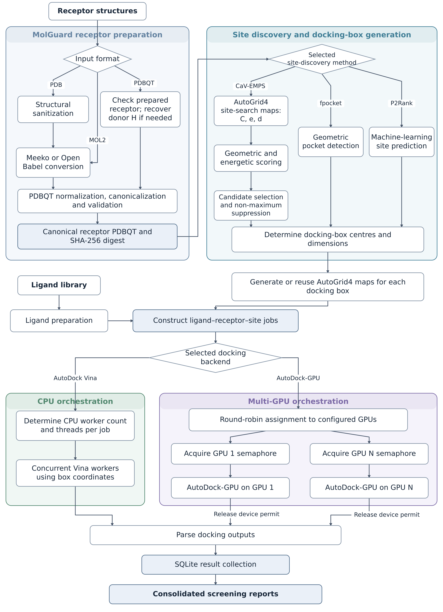

# Summary

Molecular docking is a widely used method in modern structure-based drug discovery that predicts how small molecules interact with macromolecular targets, including their orientations, conformations, and binding affinity. High-throughput virtual screening (HTVS) uses these docking engines to evaluate compound libraries (NCBI, ZINC [@irwin2020zinc20], etc.) containing thousands to millions of candidates against therapeutic targets. However, standard docking campaigns are constrained by manual configurations and researcher inputs.

[‘Ultidock’](https://ultidock.org/) is an open-source, automated virtual screening pipeline that provides an end-to-end, reproducible workflow from raw macromolecular and ligand-library inputs to consolidated multi-pose reports. It integrates an I/O hardening layer for reliability (‘Molguard’), multiple receptor cavity detection engines, multi-backend docking support (Autodock Vina [@trott2010autodock] and Autodock-GPU [@santos2021autodock]) with multi-GPU execution and load balancing for high-throughput virtual screening, and a unified SQLite data-streaming architecture.

# Statement of need

Despite ongoing research on search algorithms and scoring functions, setting up a high-throughput ligand screening campaign on a new molecular complex remains heavily bottlenecked by manual interventions. Standard protocols typically start with multi-step structural file conversions prone to numerical and formatting errors, a docking box specified by the researchers, and disparate utilities for post-processing.

Docking accuracy depends heavily on the search box placement and size on the macro molecule. For optimal results, the search box needs to be on the docking site with the correct dimensions. Although there is software that can pinpoint the binding site centre with relatively high accuracy, those software use still a step needs resarcher observation and interactions. Researcher is still required to inspect the cavity geometry and translate the point coordinates into volumetric bounding box dimensions that enclose the binding cleft without wasting search iteration on bulk receptor volume. Also relatively old fixed-column coordinate standarts (such as PDBQT) leads to formatting anomalies —including Fortran-style column overflows, unassigned Gasteiger partial charges, non-standard amino acid definitions, and missing scientific notation delimiters— regularly trigger silent execution crashes or numerical corruptions on Autogrid4 [@huey2007autogrid] map calcualtions and potential docking errors.

Ultidock targets researchers conducting repeated ligand scrreening campaigns who need automated preparation with various kinds of protein structures, different candidate site selection methods with automation, batch execution without developing a separete orchestration framework.

GPU-accelerated engines such as the official Autodock-GPU [@santos2021autodock] provide explicit electrostatic and desolvation physics at high speed, use precomputed AutoGrid4 affinity maps and support concurrent screening across multiple GPUs. Although there are multi-core computation options and GPU accelerations on existing docking engines, their CPU and GPU scheduling models vary. Ultidock provides a unified open-source pipeline that automatically sanitizes raw receptors, either reusing AutoGrid4 physical potential maps or using other binding-site discovery tools to discover and size candidate docking boxes, schedules workloads across multiple GPUs or CPU cores, and streams results into a queryable database. Ultidock coordinates device-targeted AutoDock-GPU jobs across candidate pockets and receptors, integrating their execution with preparation and database-backed result collection.

# State of the field

Commercial platforms such as Schrödinger Glide [@friesner2004glide] and BIOVIA Discovery Studio provide established docking and virtual-screening workflows under proprietary licenses..

Graphical tools such as PyRx [@dallakyan2015pyrx] and AMDock [@valdestresanco2020amdock] enable accessible docking on desktop workstations; notably, AMDock connects automated box definition and docking by integrating AutoLigand [@harris2008autoligand]. The documented PyRx and AMDock workflows focus on AutoDock4 and AutoDock Vina rather than providing built-in orchestration of AutoDock-GPU screening jobs across multiple GPUs.

BioExcel Building Blocks (BioBB) [@andrio2019biobb; @bayarri2022biobbwfs] provides modular components for reproducible biomolecular workflows. Its drug-discovery pipeline connects protein preparation, molecular dynamics, fpocket-based pocket identification, docking-box construction and screening with AutoDock Vina or GNINA. Its documented screening implementation processes ligands sequentially and exports ranked results to CSV.

Batch-oriented tools such as the graphical workbench Dockey [@dockey2020] and the command-line pipeline EasyDock [@easydock2021] streamline multi-ligand processing. Still, their docking-site options are either pre-defined docking boxes or computationally intensive whole-receptor search boxes, and both omit automated binding-site discovery.

Packages such as Open Babel [@o2011open] and Meeko [@forli2016computational] provide robust file format and molecule conversions and PDBQT generation, but their integration into fault-tolerant screening workflows requires extensive custom work and infrastructure.

Standalone pocket finders employ different methodologies. Supervised machine-learning tools such as P2Rank [@krivak2018p2rank], demonstrates strong localization on crystallographic benchmarks but carry potential distrubition biases when evaluated on non-globular, non-canonical targets, or novel allosteric sites [@utges2024comparative]. On the other hand, purely geometric pocket finders such as fpocket [@le2009fpocket], which uses Voronoi tessellation and alpha spheres and PoCavEDT [@pocavedt2023], which uses Euclidean Distance Transform (EDT), are computationally efficient methods yet frequently assign non-druggable internal packing voids or solvent inaccesible channels over true binding sites [@schmidtke2010dpocket; @volkamer2012dogsitescorer; @utges2024comparative].

Energy-grid methods—such as ICM’s PocketFinder [@an2005pocketfinder], which uses Gaussian convolutions of Lennard-Jones potentials, or AutoLigand [@harris2008autoligand] and AutoSite [@ravindranath2016autosite], which rely on AutoGrid4 probe affinity and electrostatic maps—can be biased toward steep, solvent-exposed surface contacts unless regionally regularized or filtered by buriedness [@laurie2005qsitefinder; @ravindranath2016autosite].

Ultidock was built around existing literature-based software rather than contributing piecewise, because virtual screening requires a cohesive architecture that directly couples receptor sanitisation, different methodological approaches for different receptors’ cavity discovery, and hardware-accelerated execution. By connecting these stages with a modular package ecosystem, Ultidock automates the conversion of raw receptor files into parallel screening without manual intervention. A separate implementation for each receptor provides a common environment for developing and evaluating CaV-EMPS while supporting established pocket predictors and docking engines. The modular separation of site prediction from docking execution allows candidate-generation methods to be changed while retaining the surrounding preparation and result-collection workflow. Its contribution combines this methodological component with the software infrastructure needed to carry candidate sites through to consolidated screening results.

# Software Design

Ultidock’s main purpose is to create fully automated, physically and scientifically evaluable batch HPC docking campaigns and make them available to researchers worldwide. For this purpose, Ultidock focuses on reliability, scientific accuracy, and headless automation while maintaining a relatively modular architecture.

Ultidock was designed primarily for headless operation and HTVS (High-throughput virtual screening). As a result, Molguard is designed for deterministic results, essentially an open-babel [@o2011open] and Meeko [@forli2016computational] wrapper for receptor canonicalisation. This layer validates fixed-column PDBQT formatting before grid calculation, automatically repairing Fortran-style column overflows, scientific notation artefacts, and missing partial charges. During receptor sanitization, Molguard strips bulk crystallographic water and buffer additives while retaining catalytic monoatomic ions and specified cofactors, recording SHA-256 checksum manifests for reproducibility ([MolGuard documentation](https://docs.ultidock.org/en/release-v1.1.2/scientific-background/molguard-canonicalization.html)).

Another important stage in the docking campaigns is deciding where to dock the molecules. To automate this job, we first created our own binding-site searcher. Cav-Emps (Cavity detection via Electrostatic Map Pocket Scoring), which combines Hybrid Energy-Geometry Integration, 3D EDT (Euclidean Distance Transform) for geometric void-depth calculation with Autogrid interaction potentials (carbon affinity $C$, electrostatics $e$, and desolvation $d$). It also combines spatial convolution with regional spatial-smoothing energy grids to suppress narrow surface minima and identify deep cavities capable of multi-contact ligand coordination. After the algorithm identifies the binding area, the rest is automated bounding-box generation. Non-maximum suppression reduces spatial redundancy among ranked cavity proposals. The pipeline then converts the retained proposals into docking-box configurations for the selected engine, formatted natively for AutoDock Vina or AutoDock-GPU. The pipeline also supports external, self-proven binding site predictors such as fpocket [@le2009fpocket] and p2rank [@krivak2018p2rank] through modular adapters.

Docking execution supports AutoDock Vina for CPU computation and AutoDock-GPU on GPUs. For AutoDock-GPU, round-robin job allocation and per-device semaphores control concurrent jobs. The system collects docking scores and engine-reported pose metrics as a desired output file in SQLite database as the pose file names and related metrics for querying and later inspection.

{#fig:pipeline width="100%"}

# Research Impact Statement

CaV-EMPS was evaluated on COACH420 and HOLO4K, comprising 519 and 10,861 evaluable reference sites, respectively. On COACH420, with at most six predictions per target and a centre-to-nearest-ligand-atom distance (DCA) threshold of 4 Å, Top-($n+2$) recall was 65.13%, compared with 53.56% for fpocket and 77.46% for P2Rank, where $n$ denotes the number of reference sites per target. Ablation experiments supported the contribution of regional energy smoothing: removing it reduced recall under this protocol to 51.45%. On HOLO4K, disabling the rescue chain increased all-site recall from 36.59% to 42.35%, identifying a limitation of the default configuration.

Virtual-screening evaluation covered five DUD-E [@mysinger2012dude] targets, using AutoDock Vina for four targets and AutoDock-GPU for BRAF. Mean target-level ROC-AUC was 0.623, with mean enrichment factors of 4.19 and 2.57 at the top 1% and 5% of ranked compounds.

For a 9,984-job SERT workload (1,664 ligands screened across six candidate cavities in PDB 5I6XPDB 5I6X [@coleman2016sert]), increasing the allocation from one to five NVIDIA A40 GPUs reduced recorded benchmark wall time from 501.4 to 196.8 seconds, a 2.55-fold speedup. The SERT case study also illustrates a comparison of docking outputs across six candidate cavities while retaining site identities.

Benchmark tables, analysis scripts, and provenance materials are publicly available in the [Ultidock data archive](https://ftp.ultidock.org/), supporting inspection of the reported results and further methodological evaluation.

# AI Usage Disclosure

Large language models were utilized to assist with documentation drafting, formatting, and structural refactoring of this manuscript. The author designed, implemented, and verified all algorithmic logic, benchmark runs, empirical evaluations, and scientific code.

# References